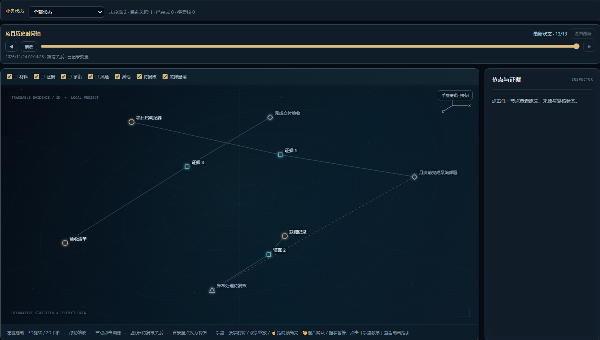

<p align="center"></p>

# AI承诺审计星图-智能体

把项目材料、承诺、风险和证据放进同一张三维星图。沿着节点和关系追溯证据原文，查看谁负责、何时到期，以及哪些发现需要人工复核。



*程序实际界面，使用合成项目材料。*

## 核心功能

- **三维星图与证据追溯**：旋转和缩放三维视图，切换二维平面，点击节点查看来源、原文与复核状态。
- **AI 辅助审计**：配置模型后，可从新增材料中提取承诺、风险及关系建议。候选结果由用户复核。
- **承诺与风险管理**：记录负责人、截止日期、处理状态和证据依据。历史时间轴支持只读回放。
- **摄像头手势**：开启并授权摄像头后，可用手势旋转、缩放、指向和确认。手势模型在设备上运行。
- **项目材料管理**：整理材料、归档或恢复记录，并导入和导出项目备份。

## 下载与使用

**[下载 Windows x64 安装包](https://github.com/yjn66627/AI-Commitment-StarMap-Agent/releases/download/release-20261123/AI-Commitment-StarMap-Agent-Windows-x64.zip)** · [发行说明与 SHA-256](https://github.com/yjn66627/AI-Commitment-StarMap-Agent/releases/tag/release-20261123)

解压下载文件后，运行中文安装程序。选择空的自定义父目录时，安装程序会创建专属子目录。标准卸载保留项目资料。压缩包还包含中文卸载入口和使用说明。安装器未签名，Windows 可能显示未知发布者。在线 AI 需要自行配置模型与 API Key，启用后会向配置的模型服务发送分析所需内容。项目备份不包含模型配置和密钥。

## 技术架构与构建

界面通过 Electron 运行，Node.js 服务管理项目、证据和模型请求。二维和三维关系视图读取同一项目记录。MediaPipe 提供设备端手部关键点识别。Windows x64 安装程序使用 NSIS。

在 Windows x64 上使用 Node.js 22.12 或更高版本，在源码目录中执行：

```powershell
cd desktop
npm ci
npm run verify:gestures
npm run check
npm start
```

将 `STARMAP_MAKENSIS` 设为 Windows NSIS 编译器的绝对路径。使用 electron-builder 缓存的 NSIS 时，还需按该工具链设置 `NSISDIR`。运行 `npm run make:win` 构建 NSIS 安装程序。工程含依赖锁、离线手势资源和测试代码。

## 项目团队与贡献

| 成员     | 项目角色         | 主要贡献                                    | GitHub                                      |
| ------ | ------------ | --------------------------------------- | ------------------------------------------- |
| **小杨** | 项目负责人、核心全栈开发 | 整体技术架构、前后端系统开发、AI能力集成、隐私保护机制、星图可视化及工程交付 | [yjn66627](https://github.com/yjn66627)     |
| **小刘** | 系统测试与工程验证    | APP调试、功能测试、运行验证、问题反馈及现场展示准备             | [wooden1234](https://github.com/wooden1234) |
| **小林** | 产品策划与竞赛材料制作  | 产品创新创意、产品定位、PPT与视频审查、材料整理及交付协调          | [zirui13579](https://github.com/zirui13579) |

## 使用限制及第三方许可

正式验收覆盖离线手势资源。真实在线模型调用、真人手势识别和任务栏图标外观在该发行包上尚未人工复验。AI 输出需结合证据和业务背景人工核对。

第三方许可随组件保留。Cytoscape.js 使用 MIT 许可，MediaPipe 组件与 [Hand Landmarker 模型](https://huggingface.co/litert-community/MediaPipe-HandLandmarker-Full) 使用 Apache 2.0 许可，Electron 与 Chromium 的许可及声明见 [third-party](third-party/)。项目未指定项目级开源许可。

